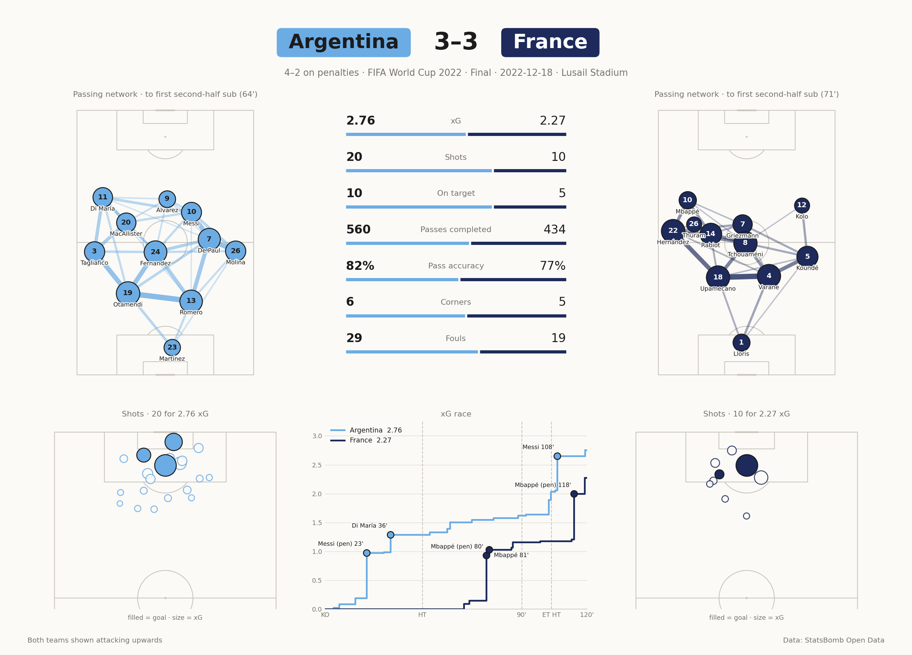

# match-report

One-page football match reports from [StatsBomb Open Data](https://github.com/statsbomb/open-data): both passing networks, both shot maps, an xG race chart and a stats comparison. Ask an AI assistant for "the 2022 World Cup final" and get this:



It ships two ways, built on the same code:

- **An MCP server** for any MCP client (Claude Code, Claude Desktop and others). Runs locally over stdio; nothing to host, no API key.
- **A Claude Code skill** for people who would rather drop a folder into their project.

## MCP server

Requires Python 3.10+.

```bash
pip install git+https://github.com/miguelmolina95/match-report
```

That puts a `match-report-mcp` command on your path. Register it with your client.

Claude Code:

```bash
claude mcp add --scope user match-report -- match-report-mcp
```

Claude Desktop, or any client that takes a JSON config:

```json
{
  "mcpServers": {
    "match-report": { "command": "match-report-mcp" }
  }
}
```

If the client cannot find the command, use its absolute path (`which match-report-mcp`).

### Tools

| Tool | What it does |
|---|---|
| `find_matches` | Search by team, year, competition or stage; returns match ids |
| `list_competitions` | What competition-seasons exist, with match counts |
| `match_summary` | Score, scorers and minutes, xG, shots, passing for one match |
| `match_shots` | Every shot with player, minute, xG, outcome and location |
| `match_report` | The report image, plus the summary and a full-resolution PNG path |

All tools are read-only. The server writes only to its cache, `~/.cache/match-report` (override with `MATCH_REPORT_CACHE`).

## Claude Code skill

Copy `skills/match-report` into `~/.claude/skills/` (all projects) or `.claude/skills/` (one project), and install its dependencies:

```bash
pip install requests matplotlib mplsoccer
```

The scripts also work on their own:

```bash
python3 skills/match-report/scripts/find_match.py argentina france 2022
```

```bash
python3 skills/match-report/scripts/match_report.py 3869685 --home-color "#6CACE4" --away-color "#1D2A5B"
```

## Try it

- "Show me the match report for the 2022 World Cup final."
- "What women's competitions have data?"
- "Who had the better chances when Leverkusen beat Bayern 3-0 in 2024?"

## What it covers, and what it doesn't

StatsBomb Open Data is a curated free sample: about 80 competition-seasons and 4,000 matches, including World Cups, Euros, Copa América, much of Messi's La Liga career, single seasons of a few leagues and a lot of women's football. It is not a live feed, and most recent club matches are not in it.

## How the numbers are computed

- Goals are counted from events and cross-checked against the official result.
- Own goals count towards the score but carry no xG.
- Extra time is included. Penalty shootouts are reported separately and excluded from goals, shots and xG.
- Each passing network covers one settled XI: kick-off until that team's first substitution after half-time. A first-half replacement is swapped in.
- Pass links use the receiver named in the data.

## Known limits

- Players with the same average position overlap in the passing network.
- Name labels use the last word of a name, so some multi-word surnames are shortened.
- The skill's scripts and the server package carry separate copies of the data and rendering code.

## Attribution

Data is provided by StatsBomb under their open-data licence, which asks that published work credits them and shows their logo. The report image carries a "Data: StatsBomb Open Data" footer. This project is not affiliated with StatsBomb.
